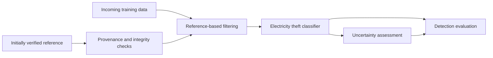

# ChainGuard — Research Case Study

## Blockchain-Anchored Data Provenance for Poisoning-Resilient IoT-Based Electricity Theft Detection

**Authored research by Muhammad Ahmad**

I authored ChainGuard to investigate a weakness in machine-learning-based electricity theft detection: a model can perform well on clean data while becoming less useful when its training data is corrupted.

The research brings together reference-data provenance, influence-based sample filtering, and conformal uncertainty monitoring. Its central idea is to connect the integrity of the data used for learning with the reliability of the detector built from that data.

**Research areas:** Trustworthy machine learning · Data poisoning defense · IoT security · Electricity theft detection · Blockchain-oriented provenance.

**Tools:** Python, LightGBM, scikit-learn, pandas, NumPy, imbalanced-learn, SHAP, Matplotlib, and notebook-based experimentation.

This repository contains a public research narrative. The authored paper, implementation, datasets, exact thresholds, and reproduction details are retained privately.

## The problem

An electricity theft detector depends on the readings and labels used to train it. If those records are manipulated, a model may learn a distorted picture of normal consumption and miss the behavior it was intended to detect.

There are two related questions:

1. Can a training reference be checked for consistency with an earlier trusted record?
2. Does the detector remain useful as potentially corrupted data enters the learning process?

A stored record of an anomaly does not, by itself, answer the second question. ChainGuard investigates whether provenance checks can support the training workflow and whether uncertainty can provide an additional signal of degradation.

## Why it matters

For a utility or smart-meter operator, the useful outcome is identifying suspicious consumption accurately enough to support investigation. A reassuring aggregate accuracy score can be misleading when most records are normal and theft recall has collapsed.

| Operational concern | Research response |
| --- | --- |
| Historical training records may be altered | Integrity checks tied to a retained reference |
| Incoming samples may harm the detector | Influence-based acceptance and quarantine logic |
| Accuracy can conceal missed theft | Evaluate recall, F1, and discrimination alongside accuracy |
| Model confidence may change under contamination | Inspect conformal prediction-set behavior |
| Recording every measurement separately may add overhead | Explore batched provenance commitments |

These are motivations and intended applications. The work does not demonstrate a deployed utility system or measured financial savings.

## The proposed framework

### C1 — Data trust anchor

The design assumes an initially verified collection of readings. Hashes and Merkle commitments provide a way to check later records against that reference. Blockchain anchoring is the proposed persistence mechanism for the commitments.

The supplied implementation exercises hashing, Merkle proofs, and a local reference. It does not include live blockchain transaction receipts or a deployed anchoring contract.

### C2 — Reference-based influence filtering

Incoming training samples are assessed against reference behavior to identify potentially harmful influence. The framework distinguishes trusted, flagged, and quarantined data paths.

The experimental ChainGuard condition also retains reference examples in the training process. That affects how its result should be compared with the other conditions.

### C3 — Conformal uncertainty monitoring

Prediction sets provide a different view of the model's output from a single class label. The research investigates whether wider or ambiguous sets become more common as training contamination increases.

This is evaluated as an experimental signal, not a proven guarantee of early warning in a live stream.

**Trust boundary:** A matching hash establishes consistency with the committed representation. It does not prove that the original sensor reading or its label was truthful. The design still depends on how the initial reference is verified and protected.

[Explore the conceptual methodology →](docs/methodology.md)

## Experimental design

The notebook uses a 50,000-row working subset of the UCI Individual Household Electric Power Consumption dataset, with engineered features and synthetic theft labels. It compares an undefended LightGBM model, a RONI-style filtering condition, and a ChainGuard condition under two simulated contamination modes.

The public UCI dataset contains household measurements rather than verified electricity theft labels. The theft and poisoning conditions are constructed for the experiment. [Dataset source and attribution](https://archive.ics.uci.edu/dataset/235).

## Selected results from the saved notebook

For the **20% gradual-poisoning condition**, the saved output reports the following means over three runs:

| Experimental condition | Accuracy | Theft recall | F1 |
| --- | ---: | ---: | ---: |
| No defense | 76.01% | 20.54% | 33.93% |
| RONI-style filtering | 75.69% | 19.48% | 32.45% |
| ChainGuard | 77.17% | 24.50% | 39.16% |

In that condition, ChainGuard records a **3.96 percentage-point recall increase** over no defense, while substantial detection degradation remains. The saved clean baseline has 90.80% accuracy and 77.93% recall.

The experiment therefore supports a partial improvement in selected settings, not complete poisoning resistance. ChainGuard does not outperform the alternatives at every tested contamination level, and performance remains poor under severe contamination.

The saved uncertainty outputs also show broader prediction sets in some poisoned conditions. Their usefulness as a timely operational alarm requires a separate chronological evaluation.

These figures are transcribed from historical notebook output; the complete experiments were not rerun for this case study. [Evidence and evaluation limits →](docs/evidence.md)

## What this work demonstrates

- An integrated research prototype connecting provenance, filtering, classification, and uncertainty.
- Experimental comparison of a detector under clean and contaminated training conditions.
- Analysis of recall and F1 rather than accuracy alone.
- Local Merkle membership verification and tamper checks.
- A concrete separation between cryptographic integrity and the assumptions needed to trust original measurements.

The contribution is the authored framework, implementation, and investigation. This case study does not claim that blockchain, RONI, conformal prediction, or their individual algorithms were invented by this work.

## Attribution

**Authored paper:** *ChainGuard: Blockchain-Anchored Data Provenance for Poisoning-Resilient IoT-Based Electricity Theft Detection* — Muhammad Ahmad.

**Base paper:** Soiful Hadi, Wahyul Amien Syafei, and Adi Wibowo, *Ambient Intelligence to Detect Misuse of Electricity Consumption Based on IoT Using Blockchain Technology*. [DOI record](https://doi.org/10.1109/ACCESS.2025.3561677).

**Dataset:** Georges Hebrail and Alice Berard, *Individual Household Electric Power Consumption*, UCI Machine Learning Repository. [Dataset record](https://archive.ics.uci.edu/dataset/235). The dataset is provided under CC BY 4.0; its creators are separate from this research's author.

## Resume summary

> Authored ChainGuard research on poisoning-resilient electricity theft detection, implementing a Python prototype combining Merkle-based reference integrity, influence filtering, LightGBM classification, and conformal uncertainty analysis on synthetic contamination experiments.

**Portfolio link:** [ChainGuard — Research Case Study](https://github.com/AhmadTariq-4090/chainguard-electricity-theft-detection-case-study)

## Repository scope

This public repository contains newly written documentation and conceptual diagrams only. Paper files, code, notebook outputs, datasets, original figures, and exact experimental recipes remain private. No claim of a live blockchain deployment, certified security, or independently replicated benchmark follows from this narrative.
